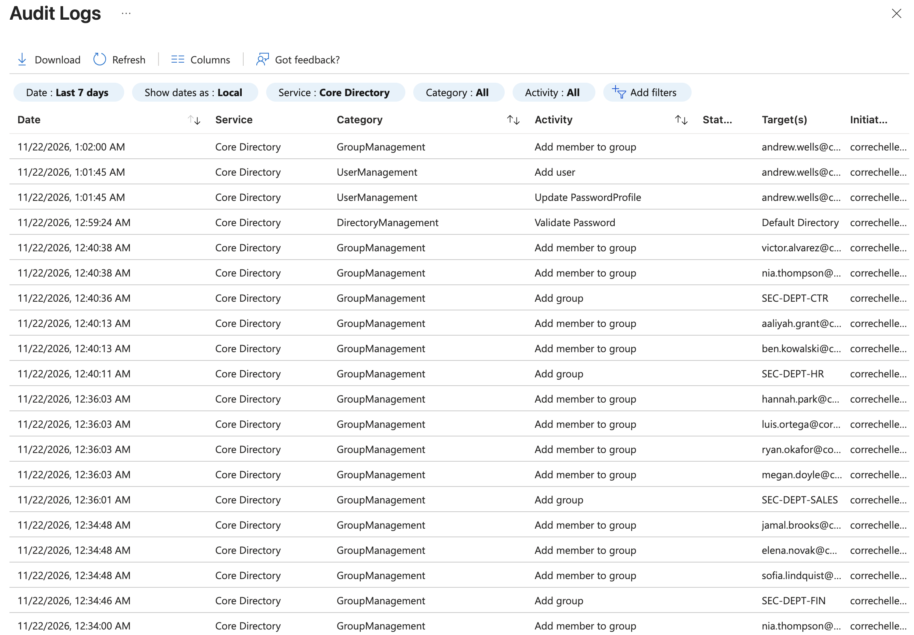

# Northwind Services

## Project Overview

Northwind is a fictitious company transferring ad-hoc, identity tracking processes to a structured Entra ID directory instance.

## Business Scenario

Northwind Services is a 15-person company that has been running on shared
logins and a spreadsheet of who has access to what. They are moving to Microsoft
Entra ID and they have hired me to set the directory up properly the first time.

## Tools Used

- Microsoft Entra ID (Free Tier)

## What I Built

I created 16 identities and 6 security groups in Entra ID to represent 16 humans that Northwind trusts.

## Screenshots

## Security Lessons Learned

When designing security groups, it is important to consider trade-offs and improvements relative to future growth and expansion. This makes managing groups, users and ultimately, permissions less complex as an organization scales.

## Future Improvements

Create supplementary documentation that governs the group creation process. 
